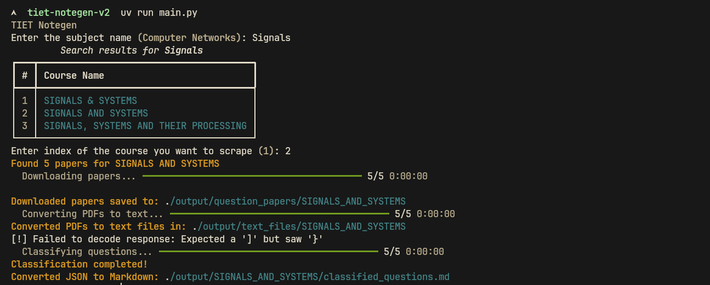

# TIET Notegen
TIET Notegen is a lightweight tool that scrapes [Thapar University's Question Paper Archive](https://cl.thapar.edu/ques.php) for past exam papers of a given course and intelligently classifies the questions into structured topics using the opencode Go API (`deepseek-v4.1-flash`).

 

## Examples
A few example PDFs generated by TIET Notegen:
- [Data Structures and Algorithms](./examples/DATA_STRUCTURES_AND_ALGORITHMS.pdf)
- [Computer Networks](./examples/COMPUTER_NETWORKS.pdf)
- [Probability and Statistics](./examples/PROBABILITY_AND_STATISTICS.pdf)

### Features
- 🔍 Automated Scraping – Fetches question papers directly from Thapar's official site based on course name.
- 🧠 Smart Classification – Uses the opencode Go API (`deepseek-v4.1-flash`) to organize questions by topic, rephrasing incomplete or diagram-based questions as needed.
- ♻️ Deduplication & Cleanup – Merges similar topics, removes duplicates, and outputs clean, study-ready JSON.
- 🗂️ Study-Friendly Output – Generates a topic-wise breakdown of questions for easy revision and content structuring.

### Usage
1. Install the required dependencies:
   ```bash
    # pip
    pip install -r requirements.txt

   # uv
   uv add -r requirements.txt
   ```
2. Set up your opencode API key in the `.env` file:
   ```plaintext
   OPENCODE_API_KEY=your_api_key_here
   # Optional: override the API base URL (defaults to https://opencode.ai/inference/go/v1)
   # OPENCODE_BASE_URL=https://opencode.ai/inference/go/v1
   # Optional: stable session ID sent as `x-opencode-session` for routing/caching
   # (a random one is generated per run if unset)
   # OPENCODE_SESSION_ID=tiet-notegen-session-1
   ```
   The classifier and merger both default to `deepseek-v4.1-flash` via the
   opencode Go OpenAI-compatible endpoint.
3. Run the script to generate notes for a specific course:
   ```bash
    # python
    python main.py

   # uv
   uv run main.py
   ```

## TODOs
- [-] Smart Batching
- [ ] Multithreaded Downloading
- [ ] Better Error Handling
